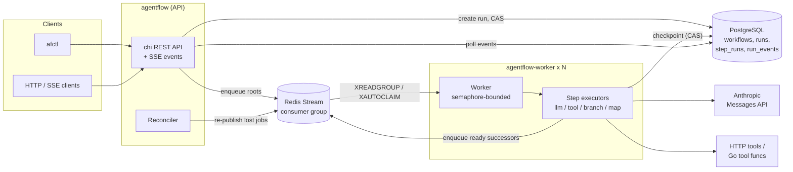
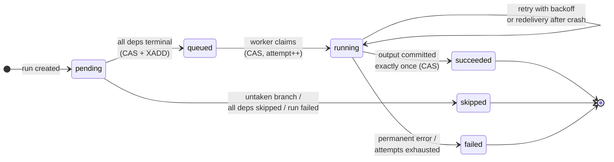

# agentflow

[](https://github.com/RatulSikder97/agentflow/actions/workflows/ci.yml)
[](https://pkg.go.dev/github.com/RatulSikder97/agentflow)
[](LICENSE)

**A durable workflow engine in Go for running LLM agent pipelines as DAGs.**

You describe a pipeline in YAML (LLM calls, tools, branches, fan-out). agentflow
runs it across a pool of workers and saves a checkpoint after every step. If a
worker dies halfway through a run, another worker picks the run up from the
last finished step. Steps that already finished are never run again, and their
outputs are never overwritten.

```yaml
steps:
  - id: plan
    kind: llm
    output: json
    prompt: 'Plan research on {{ .input.topic }}. Return {"subtopics": [...]}.'
  - id: research
    kind: map                        # fan out, 3 at a time
    depends_on: [plan]
    over: steps.plan.output.subtopics
    concurrency: 3
    step: {kind: llm, prompt: "Write a research note on {{ .item }}."}
  - id: brief
    kind: llm
    depends_on: [research]
    prompt: "Synthesize: {{ json .steps.research.output }}"
```

- **DAG scheduling** with bounded concurrency (`errgroup` + `semaphore`) at the worker level and per `map` step
- **Retries** per step, with exponential backoff and jitter. Each attempt has its own timeout, enforced through `context`
- **Idempotent, checkpointed steps** keyed by `(run_id, step_id)`. A crashed run resumes from its last finished step
- **PostgreSQL** store (pgx, golang-migrate) and **Redis Streams** queue (consumer groups, with `XAUTOCLAIM` to take over stuck jobs). In-memory versions of both are included for tests and single-process use
- **Anthropic Messages API** provider over plain `net/http` (default model `claude-sonnet-5-5`), plus a deterministic fake LLM
- **REST API** (chi), **Server-Sent Events** run stream that can resume from `Last-Event-ID`, **Prometheus** `/metrics`, and **OpenTelemetry** spans whose trace context travels through the queue

## Architecture



No process keeps a run in memory. The Postgres `step_runs` table is the single
source of truth. The queue carries hints ("step X of run Y may be ready"), and
every scheduling decision is recomputed from the checkpoints.

### Run lifecycle



When a step finishes, the worker that ran it calls the scheduler (`advance`).
`advance` reads every step row of the run. It queues pending steps whose
dependencies are all finished, skips steps on branches that were not taken, and
marks the run `succeeded` or `failed` once no step is left. Every write it makes
is a compare-and-set, so any number of workers can run `advance` for the same
run at once and still end up in the same state.

## Quickstart

Requires Go 1.26+.

### 1. Run an example locally (no infrastructure, no API key)

```bash
git clone https://github.com/RatulSikder97/agentflow && cd agentflow

go run ./cmd/afctl run -f examples/support-triage/workflow.yaml \
  -fixtures examples/fake-llm.yaml \
  -input '{"ticket_id":"T-1042","subject":"Double charge","body":"I was charged twice, please refund one payment."}'
```

```
run run_bh07c01d75c7de90 (support-triage)
   0.000s  run.started                        {"workflow":"support-triage","workflow_id":"wf_vlsplnpdqs294itn"}
   0.000s  step.queued     classify
   0.000s  step.started    classify           {"attempt":1}
   0.000s  step.succeeded  classify           {"attempt":1,"duration_ms":0}
   0.000s  step.queued     route
   0.000s  step.started    route              {"attempt":1}
   0.001s  step.succeeded  route              {"attempt":1,"duration_ms":0}
   0.001s  step.queued     billing_reply
   0.001s  step.skipped    technical_reply
   0.001s  step.skipped    general_reply
   0.001s  step.started    billing_reply      {"attempt":1}
   0.001s  step.succeeded  billing_reply      {"attempt":1,"duration_ms":0}
   0.001s  step.queued     record
   0.001s  step.started    record             {"attempt":1}
   0.001s  step.succeeded  record             {"attempt":1,"duration_ms":0}
   0.001s  run.succeeded

outputs:
  classify:
    {
      "category": "billing",
      "priority": "high",
      "reason": "customer requests a refund"
    }
  route:
    {
      "taken": [
        "billing_reply"
      ],
      "case": 0
    }
  ...
```

The other example fans out research over subtopics:

```bash
go run ./cmd/afctl run -f examples/research-summarize/workflow.yaml \
  -fixtures examples/fake-llm.yaml -input '{"topic":"small language models"}'
```

To use Claude instead of the fake, export `ANTHROPIC_API_KEY` and pass `-llm anthropic`.

### 2. Run the full distributed stack

```bash
docker compose up --build        # postgres + redis + server + 2 workers, fake LLM
```

```bash
go build -o bin/ ./cmd/...
WF=$(./bin/afctl submit -f examples/support-triage/workflow.yaml | jq -r .id)
RUN=$(./bin/afctl start "$WF" -input '{"ticket_id":"T-7","subject":"Login broken","body":"I get an error 500 when I sign in"}' | jq -r .id)
./bin/afctl watch "$RUN"         # live SSE stream
./bin/afctl status "$RUN"        # run + checkpointed step outputs
```

To call Claude for real: `AGENTFLOW_LLM=anthropic ANTHROPIC_API_KEY=... docker compose up --build`.

### REST API

| Method | Path | Description |
|---|---|---|
| `POST` | `/v1/workflows` | Submit a workflow (raw YAML body). Returns `201 {id, name}`. `400` on YAML syntax errors, `422` with every validation problem |
| `GET` | `/v1/workflows/{id}` | Fetch a stored workflow |
| `POST` | `/v1/workflows/{id}/runs` | Start a run. Body `{"input": {...}}`. Returns `422` if required inputs are missing |
| `GET` | `/v1/runs/{id}` | Run status plus every step's status, attempt count, output and error |
| `GET` | `/v1/runs/{id}/events` | SSE stream of run events. Resume with `Last-Event-ID` or `?after=<seq>`. Closes after the run's terminal event |
| `GET` | `/metrics` | Prometheus metrics |
| `GET` | `/healthz` | Liveness |

```bash
curl -X POST localhost:8080/v1/workflows -H 'Content-Type: application/yaml' \
  --data-binary @examples/research-summarize/workflow.yaml
curl -X POST localhost:8080/v1/workflows/$WF/runs -d '{"input":{"topic":"vector databases"}}'
curl -N localhost:8080/v1/runs/$RUN/events
```

## Workflow YAML reference

```yaml
name: my-pipeline            # required
description: optional text
inputs: [topic]              # required keys in the run input

defaults:                    # inherited by every step
  model: claude-sonnet-5-5   # default
  timeout: 2m                # per attempt; default 2m
  retry:
    max_attempts: 3          # default 3 (1 = no retries)
    backoff: 500ms           # base delay; default 500ms
    max_backoff: 30s         # cap; default 30s

steps:
  - id: step_id              # ^[a-z][a-z0-9_]*$
    kind: llm | tool | branch | map
    depends_on: [other_step]
    timeout: 30s             # overrides defaults
    retry: {max_attempts: 5} # unset fields inherit defaults
```

| Kind | Fields | Output |
|---|---|---|
| `llm` | `prompt` (required), `system`, `model`, `max_tokens` (default 4096), `output: text\|json` | The response text, or the parsed JSON value when `output: json`. Code fences and surrounding prose are tolerated. Invalid JSON is retried |
| `tool` | `tool: <name>` + `args: {...}`, **or** `http: {method, url, headers, body}` | The Go function's return value, or `{status, body}` for HTTP (JSON bodies are decoded) |
| `branch` | `cases: [{when, then: [step_ids]}]`, `default: [step_ids]` | `{"taken": [...], "case": n}`. The first case whose `when` is true wins. Targets not taken are `skipped` |
| `map` | `over` (dotted path to a list), `step` (an inline `llm` or `tool` step), `concurrency` (default 4) | A list of item outputs, in input order |

**Templates.** `prompt`, `system`, `args` values, `http` fields and `when` are Go
[`text/template`](https://pkg.go.dev/text/template)s, rendered against this data:

| Expression | Value |
|---|---|
| `.input.<key>` | Run input |
| `.steps.<id>.output` | Output of a step that succeeded |
| `.item`, `.index` | The current element and its index inside a `map` step |

Extra functions: `json`, `join`, `upper`, `lower`, `trim`, `contains`, `default`,
`first`. Referencing a key that does not exist is an error, so typos fail
loudly. Use `{{ with index .steps "maybe_skipped" }}...{{ end }}` for steps that
may have been skipped.

**Built-in tools:** `echo` (returns its args), `word_count`, `sleep`. Register
your own with `tool.Registry.Register("name", func(ctx, tool.Call) (any, error))`.
Wrap an error with `tool.Permanent(err)` to fail the step without retrying.

**Scheduling rules.** A step runs once all its dependencies are finished, none
of them failed, and at least one succeeded. If every dependency was skipped, the
step is skipped too. This lets a join step that depends on every branch arm run
after whichever arm was taken (see [`support-triage`](examples/support-triage/workflow.yaml)).
When any step fails, the run fails and every step that has not started is skipped.

### Configuration

| Variable | Default | Used by |
|---|---|---|
| `AGENTFLOW_ADDR` | `:8080` | server |
| `DATABASE_URL` | empty (in-memory store) | server, worker |
| `REDIS_URL` | empty (in-process queue) | server, worker |
| `AGENTFLOW_LLM` | `anthropic` | `anthropic` or `fake` |
| `ANTHROPIC_API_KEY` | none | required for `anthropic` |
| `AGENTFLOW_FAKE_FIXTURES` | none | rules file for the fake LLM |
| `AGENTFLOW_WORKERS` | 4 with the in-process queue, otherwise 0 | workers embedded in the server |
| `AGENTFLOW_CONCURRENCY` | 8 | steps in flight per worker |
| `AGENTFLOW_CLAIM_IDLE` | `30s` | how long a job sits unacknowledged before another worker may `XAUTOCLAIM` it |
| `AGENTFLOW_RECONCILE_INTERVAL` | `30s` | server reconciler period |
| `AGENTFLOW_METRICS_ADDR` | `:9090` | worker `/metrics` listener |
| `OTEL_EXPORTER_OTLP_ENDPOINT` | none | enables OTLP/HTTP trace export |

## Design decisions

### Exactly-once effects on top of at-least-once delivery

Distributed queues can't promise exactly-once *delivery*. Redis Streams doesn't
either: a job is redelivered if a worker dies before `XACK`. agentflow doesn't
try to change that. It makes delivering a job twice harmless:

1. **Every state change is a compare-and-set** on the `(run_id, step_id)` row,
   e.g. `UPDATE step_runs SET status='succeeded', output=$out WHERE run_id=$1 AND step_id=$2 AND status='running'`.
   Only one writer can move a step into `succeeded`, so **a step's output is
   committed exactly once**. A worker that loses this race throws its result
   away. The store contract test races 16 goroutines to commit the same step and
   requires exactly one to win.
2. **A job is acknowledged only after its checkpoint is committed** and the
   step's successors have been queued. A crash at any earlier point leaves the
   job pending, and another worker resumes it.
3. **A job for a step that already finished is a no-op.** The worker skips the
   step, re-runs the scheduler (in case the crash happened between the commit
   and queuing the next steps), and acks the job.
4. **Each step's work is at-least-once.** If a worker crashes *while* calling an
   LLM or a tool, that call runs again. Side-effecting tools receive a stable
   `IdempotencyKey` (`run_id/step_id[/index]`, also sent as the
   `Idempotency-Key` header by HTTP tools) so they can deduplicate. That is the
   only correct place to deduplicate, because only the tool knows what "same
   request" means.

The attempt counter is stored in the database and incremented *before* each
attempt. A step that crashes its worker every time therefore runs out of
attempts and fails, instead of looping forever between workers.

### Why the queue carries hints, not state

Jobs carry only `{run_id, step_id, trace}`. Workers re-read the checkpoints
before doing anything, so a lost, duplicated or reordered job can't corrupt a
run:

- **Lost job.** A crash between the `pending -> queued` update and `XADD` leaves
  a step stuck in `queued`. The server's reconciler finds `queued` steps older
  than `AGENTFLOW_RECONCILE_INTERVAL` and publishes them again.
- **Stuck job.** The worker died while the step was `running`. The job stays in
  the consumer group's pending entries list, and another worker claims it with
  `XAUTOCLAIM` once it has been idle for `AGENTFLOW_CLAIM_IDLE`. Workers running
  long steps keep their claim alive by calling `XCLAIM` on their own messages
  every `CLAIM_IDLE/3`, which resets the idle timer.

### Other choices

- **`map` commits as one unit.** If one item fails, all items are retried.
  This keeps one checkpoint row per step. The cost is repeating the items that
  had already succeeded. For expensive fan-outs, use separate steps.
- **Workflows are immutable.** Submitting a workflow returns a new ID, and a run
  always runs the exact spec it started with.
- **Events are stored in Postgres, not pushed.** Any API replica can serve any
  run's SSE stream, and clients resume with `Last-Event-ID`. The cost is a
  200 ms polling delay.
- **Small interfaces defined by their callers.** `engine.Store`,
  `engine.Enqueuer`, `engine.Completer` and `api.Service` are declared where they
  are used. Implementations return concrete structs. The same contract suite
  ([`store/storetest`](store/storetest/storetest.go)) runs against `memstore`
  and `pgstore`.
- **No temperature or sampling parameters** are sent to the Messages API.
  `thinking` blocks are ignored, and `stop_reason: "refusal"` becomes a
  non-retryable error.

## Testing

```bash
make race          # unit tests with -race (store/queue contracts, engine, API, CLI)
make lint          # golangci-lint
make services      # throwaway postgres:17 + redis:7 containers
make integration   # + pgstore contract, cross-process crash-resume against real PG/Redis
```

The headline test is
[`integration/crash_resume_test.go`](integration/crash_resume_test.go). It
simulates two separate processes, each with its own engine, connection pool and
Redis consumer, sharing one Postgres and one Redis:

1. Process 1 runs `fetch -> enrich (map) -> slow -> publish` and is killed
   while `slow` is in flight.
2. The test checks the checkpoint: `fetch` and `enrich` are `succeeded`,
   `slow` is `running`, and `publish` is `pending`.
3. Process 2 starts. `XAUTOCLAIM` gives it the abandoned job, and it finishes
   the run.
4. The test asserts that every step's work was committed exactly once, that
   `slow` used 2 attempts, and that no job is left pending in Redis.

A matching in-memory test, `engine.TestCrashResume`, runs on every `go test`.

## Benchmarks

Results from runs on an Apple M4 Pro with Go 1.27.4, using `go test -bench`.
The fake LLM answers instantly, so the numbers measure engine overhead only.
In a real pipeline, LLM latency dominates.

```
$ go test -run '^$' -bench . -benchmem ./engine/ ./workflow/
BenchmarkRunChain10-12          4843     244966 ns/op    161909 B/op    1554 allocs/op
BenchmarkRunParallel50-12        694    1486365 ns/op   2187433 B/op   14299 allocs/op
BenchmarkRunMap100-12           5020     236580 ns/op    187892 B/op    2856 allocs/op
BenchmarkParse-12              20806      56478 ns/op     49415 B/op     862 allocs/op
BenchmarkRender-12           5980728        196.5 ns/op      272 B/op       9 allocs/op

$ make services
$ AGENTFLOW_TEST_DATABASE_URL=... AGENTFLOW_TEST_REDIS_URL=... \
    go test -tags integration -run '^$' -bench . ./integration/
BenchmarkPostgresRedisChain10-12      51   21731373 ns/op
```

| Scenario | Per run | Per step |
|---|---|---|
| 10 sequential LLM steps, in-memory store and queue | 245 µs | ~25 µs |
| 50 parallel LLM steps + join, 16 in flight, in-memory | 1.49 ms | ~29 µs |
| `map` over 100 items, 16 in flight, in-memory | 237 µs | ~2.4 µs per item |
| 10 sequential steps on **Postgres 17 + Redis 7** (Docker Desktop) | 21.7 ms | ~2.2 ms |

What the numbers show:

- **Per-step overhead on production backends is about 2 ms.** Each step costs
  one Redis Streams round trip plus a few Postgres reads and compare-and-set
  writes (claim, commit, queue the next step, and the event rows). An LLM call
  takes hundreds of milliseconds to seconds, so this is noise.
- **`map` is much cheaper per item than separate steps.** The items run inside a
  single job and commit once.
- **`Parallel50` shows the scheduler's O(steps) re-scan on each completion.**
  That is fine for the tens to hundreds of steps typical of agent pipelines. For
  much wider DAGs, the next step would be to track remaining dependency counts
  per step.

## Layout

```
cmd/agentflow          API server + reconciler (+ optional embedded workers)
cmd/agentflow-worker   queue consumer
cmd/afctl              CLI: validate, run (local), submit, start, status, watch
workflow/              YAML spec, validation, topological sort, templates
engine/                scheduler (advance), step execution, retries, worker, reconciler
store/                 data model; memstore, pgstore (+ migrations), storetest contract
queue/                 job type; memqueue, redisqueue (Streams + XAUTOCLAIM)
llm/                   provider types; anthropic (net/http), fake
tool/                  tool registry, built-ins, HTTP tool
api/                   chi REST + SSE
telemetry/             Prometheus metrics, OpenTelemetry setup
integration/           real Postgres/Redis tests and benchmarks
examples/              research-summarize, support-triage, fake LLM fixtures
```

## License

[MIT](LICENSE)
